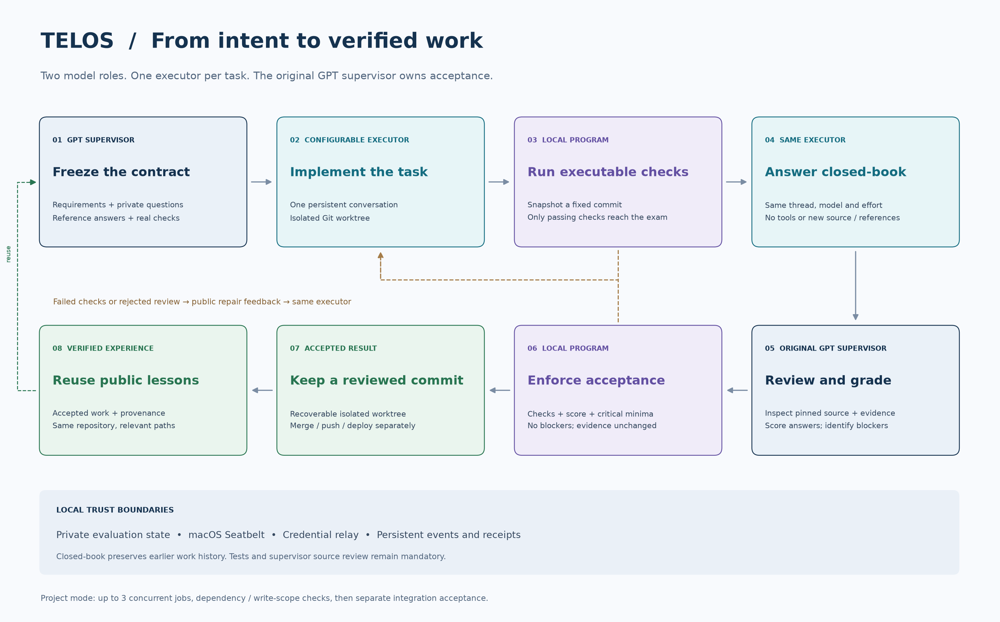
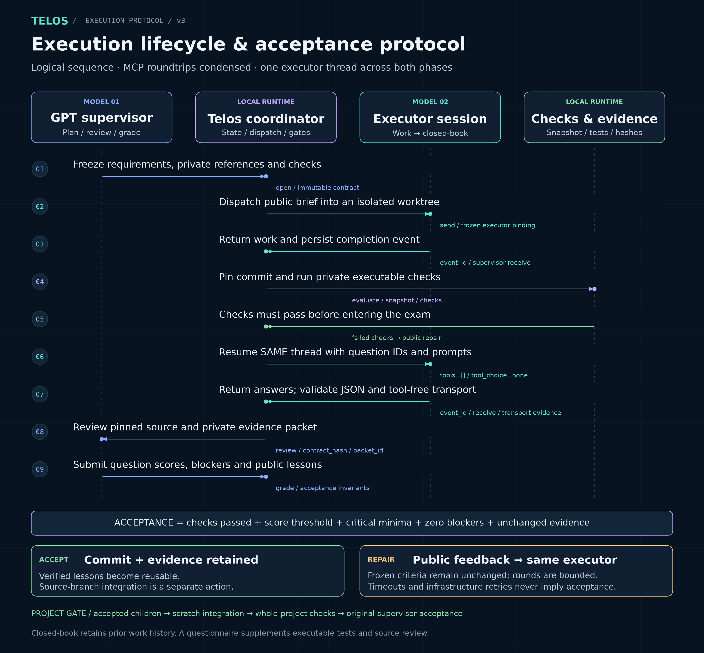

# Telos


**Turn coding goals into reviewed, testable results.**

[简体中文](README.zh-CN.md) · [Documentation](docs/README.md) · [Quick start](#quick-start) · [20-round RSI results](#20-round-rsi-campaign) · [Architecture](docs/architecture.md) · [Configuration](docs/configuration.md) · [MCP tools](docs/tools.md)

[](https://github.com/pickupdwq/telos/actions/workflows/ci.yml)
[](LICENSE)


Telos is a local MCP bridge for Codex. Your original GPT flagship conversation acts as the **supervisor**: it defines the task, freezes acceptance criteria, reviews code and decides whether the result passes. A configurable **executor** implements the change, then answers a closed-book questionnaire in the same conversation.

There are two model roles. Each task has one executor; the original supervisor owns review and acceptance. Project mode can schedule several tasks with separate executors.

**20-round RSI campaign completed:** 17 improvements accepted, 2 experiments rejected, and the final task comparison inconclusive. Local regression verification ran **3.25× faster** with four processes. Faster model responses or faster overall task delivery at equal quality have **not** been demonstrated. [Results and limits ↓](#20-round-rsi-campaign)

## System architecture

[](docs/assets/architecture-en.png)

Read left to right: the original supervisor delegates through Telos to a task executor; completion events and evidence return to the same chat. The lower half shows the runtime controls and acceptance gate. Only the supervisor and executor are model roles.

| Part | Main responsibilities |
| --- | --- |
| Original supervisor + Skill | Understand requirements, freeze scope/checks, review evidence and grade |
| Local Telos runtime | Preflight, scheduling, isolation, model relay, usage/budgets, durable callbacks and acceptance gates |
| Task executor | Work within the assigned scope, then answer the closed-book questionnaire in the same thread |

[Full-size PNG](docs/assets/architecture-en.png) · [Vector SVG](docs/assets/architecture-en.svg) · [Module map and protocol details](docs/architecture.md)

## What it does

- **Configurable executor.** DeepSeek official API by default; Volcengine Ark Coding Plan, OpenAI API and local endpoints are supported. Save several local endpoints and activate exactly one, using Responses or Chat Completions.
- **Evidence before acceptance.** Frozen executable checks run against a pinned Git commit. The supervisor then reviews the code and grades the questionnaire. Default passing score: 90/100, with critical-question minima and no unresolved blockers.
- **Same-executor closed-book exam.** The executor keeps its work conversation, but receives no new source, private answers or test results. The relay disables tools and rejects tool calls during the exam.
- **Isolated work.** Git worktrees, macOS Seatbelt restrictions, private evaluation materials and a local credential relay separate implementation from grading.
- **Project coordination.** The supervisor chooses single, parallel or phased execution; dependencies and allowed write paths are enforced. Up to three jobs can run concurrently. Integrated code receives a separate final evaluation.
- **Recoverable operations.** Persistent events, receipts, bounded retries, pause/resume/cancel, and dry-run-first archive/cleanup tools.
- **Preflight and usage control.** Check the work environment before model calls, return compact tool summaries with full evidence available, and persist request/token usage across work and exams. Configured budgets gate subsequent requests; missing usage remains explicitly unknown. See [budget semantics](docs/configuration.md).
- **Timing and actionable errors.** Separate request durations, lifecycle phases and project wall time; retain incomplete historical data. Structured errors expose stable codes, backoff guidance and available budget evidence. See [timing and errors](docs/configuration.md#timing-and-structured-errors--耗时与结构化错误).
- **Experience reuse.** Public repair lessons from accepted work can inform later tasks in the same repository. Provenance is preserved; stale lessons can be disabled. This is retrieval, not model-weight training.
- **Opt-in version comparison.** A separate `telos compare` CLI freezes two runtime snapshots and fixed tasks, reuses the original supervisor's work/exam/review gate, and reports paired outcomes, usage and time. Experiments use independent state and never promote versions automatically. [Comparison guide →](docs/comparison.md)
- **System audits.** The supervisor freezes a public checklist and execution boundaries. Executors inspect read-only source, use constrained API/browser probes, and deliver reports, logs and screenshots. The supervisor reviews coverage/evidence; confirmed findings can become repair tasks. Audit acceptance concerns investigation quality, not absence of bugs. See the [audit guide](docs/audits.md).

Telos produces accepted commits in isolated worktrees. Merging, pushing and deploying remain separate actions.

## 20-round RSI campaign

On October 20–21, 2026, Telos completed 20 experiments aimed at speed, quality and reliable reuse. The original `gpt-6-astra` supervisor at `max` directed an Alibaba Cloud Bailian executor, `deepseek-v4.1-flash-1017` at `max`, on `feature/rsi-20-rounds-20261020`, starting from main at `5e6a917`.

Each experiment followed a hypothesis and frozen checks → scoped implementation → verification → original-supervisor review → accept or reject cycle. Later rounds used earlier accepted tools: the verification CLI from round 4 gained exact selection in round 8 and optional parallel execution in round 15, then supported subsequent rounds. This is supervised recursive improvement of the software and workflow. The campaign kept the installed supervisory controller fixed and did not train model weights.

**Outcome: 17 accepted source improvements, 2 rejected experiments (10 and 16), and 1 inconclusive final comparison (20).** Rejected code was excluded. The final integrated project passed acceptance at `20c68f6`; its runtime is byte-identical to the candidate measured in round 20, `281757c`. Retries, final verification and report writing are not additional numbered rounds.

### What improved

- **Reusable verification.** An import-safe CLI records exact test IDs, outcomes, scope and timings. It supports module/class/method selection and optional fresh-process parallelism with `--jobs 1..4`; serial remains the default.
- **Local processing.** Reverse scanning accelerates log-tail positioning; bulk scanning accelerates SSE usage parsing. Experience lookup validates only the required ranked sources, and project promotion reads canonical target records rather than unrelated records. These gains concern specific local paths.
- **Reliability and observability.** Experience reuse checks current accepted provenance and isolates damaged records. Observer views tolerate malformed timestamps without inventing a current time. Status and exam summaries expose useful evidence; relay diagnostics distinguish confirmed requests that were never sent from protocol errors. Request/time and patch-format hints were added, but their effect on live retry rates is unproven.

### Optimization details

**Experience retrieval and promotion — rounds 1, 14, 17 and 19.** In [experience.py](runtime/experience.py), `lookup` filters and ranks eligible records before checking their source, stopping when it has enough valid results. Previously it checked provenance throughout the candidate set. In the 120-record fixture, three lookup scenarios fell from **120 / 120 / 120 source checks to 3 / 3 / 5**, with identical selected IDs; candidate-only inspection required none. Reading the JSON record collection is still O(N), so this is a reduction in provenance work, not an indexed lookup.

`load_record` now skips individual unreadable, invalid-JSON or ill-shaped records without hiding valid neighbors or rewriting files. `source_valid` binds a lesson to the current accepted commit, evidence packet and trusted project membership, preventing stale or relabelled records from qualifying for reuse. `promote_project` reconstructs canonical records for currently accepted children instead of scanning the entire memory collection: **300 unrelated reads became 0, with only 2 target records read**. Missing canonical records can be rebuilt and user-disabled preferences remain preserved. Evidence includes 39 damage-isolation scenarios, 22 source-identity scenarios and 15 promotion scenarios; this does not establish a live task-success gain or atomic promotion across all children.

**Log-tail positioning and observer robustness — rounds 3 and 18.** [activity.py](runtime/activity.py), `Reader.seek_tail`, replaces the Python per-byte reverse loop with `bytes.count` and a bounded `rsplit` inside at most 64 KiB blocks. It keeps byte-offset semantics while locating the required newline boundary. In the warm-cache 3.85 MB / 200-line-tail fixture, opposite-order paired medians moved from about **89.86 ms to 2.22 ms (40.55×)**; 54 independent semantic assertions passed. This is cursor positioning, not total log processing. In [watch.py](runtime/watch.py), malformed, non-finite and platform-unrepresentable timestamps now have safe ordering and an explicit `[??:??:??]` display instead of crashing or implying the current time. The observer checks covered 41 scenarios / 145 assertions. The separate oversized-line discard defect attempted in round 16 remains unresolved.

**SSE usage parsing — round 12.** [isolation.py](runtime/isolation.py), `SSEUsageTracker.feed`, scans newline-free spans in bulk rather than appending one byte at a time. It chooses a delimiter search strategy once per chunk, handles CR/LF boundaries across chunks, and preserves the retained-event byte cap and oversized-event discard behavior. An initial version slowed dense blank-line cases by 4.2–4.5× and was rejected; the accepted repair removed that regression. Equivalence checks covered **1,003 scenarios / 349,538 assertions**. Synthetic benchmarks in both execution orders measured about **61× for large events, 254–258× for oversized input and 3.31–3.32× for small input**. These timings exclude network and model execution.

**Verification selection, reporting and parallelism — rounds 4, 8 and 15.** [verify_all.py](runtime/verify_all.py) now runs only through `main`, exposes `--list`, supports repeatable `--module` / exact `--test` selection, and records per-test IDs, outcomes and timing. This lets later workers run an appropriate local subset while the supervisor retains full host verification. Optional `--jobs 2..4` distributes modules to fresh processes, combines results in stable report order, and reports worker failures or malformed/missing results as failures rather than passing incomplete coverage. Default execution remains serial. The final same-commit 527-test comparison is below; the CLI was actually reused in later rounds.

**Project callbacks — rounds 2 and 7.** [projects.py](runtime/projects.py) and [compact.py](runtime/compact.py) expose `return_event.id` and `return_event.status` in full and compact project status, removing the need to inspect private courier files just to recover an event identity. Notification logic suppresses a new wake-up only for a healthy, active, running-only transition with nothing for the supervisor to do. Existing outstanding events, receipts/reminders, completed work and error states remain actionable. Checks covered 20 phase/status combinations in both views, plus 24 suppressed states, 27 preserved actionable states and 6 existing courier states. No live callback-latency improvement was measured.

**Closed-book exam format and evidence — rounds 5 and 9.** [closed_book.py](runtime/closed_book.py) explicitly requests `text.format.type=json_object` for the tested Bailian/model binding and supplies the exact answer schema and IDs on format retries. Tools remain disabled and the strict answer parser still rejects malformed or incomplete answers. Per-attempt `format_valid`, bounded `format_error` and requested format markers survive [compact.py](runtime/compact.py) summaries without copying arbitrary model error text. Three actual development-pilot exam receipts were replayed through both summary routes to verify this evidence. The change improves protocol visibility; it has not demonstrated fewer live exam retries.

**Work closeout and editing guidance — rounds 6, 11 and 13.** [isolation.py](runtime/isolation.py) adds fresh, advisory admission-time and further-work-request allowances to supported work-phase Responses requests, after accounting for the current reservation and exam reserve. A relay fixture observed allowances **2 → 1 → 0** while preserving 3 work requests plus 2 exam requests. Only a rejection from `closeout.begin` receives the explicit “no upstream request was sent” diagnostic; later timeouts retain their protocol/transport classification. Five loopback scenarios verified the no-send boundary. [executor.py](runtime/executor.py) also supplies raw patch syntax and a scoped fallback suggestion on initial/resumed implementation turns after successful preflight. These hints do not loosen budgets or permissions or impose a new hard retry cap. Five malformed-patch rejections still occurred during round 13, so reduced editing failures are not claimed.

### What “faster” means here

The final local verification compared **the same accepted commit and the same 527 tests** on one host:

| Native regression verification | Serial, default | Four processes, opt-in |
| --- | ---: | ---: |
| Tests executed and passed | 527 | 527 |
| Failures / errors / skips | 0 / 0 / 0 | 0 / 0 / 0 |
| Elapsed time | 162.63 s | 50.04 s |
| Speedup relative to serial | 1× | **3.25×** |

The complete test IDs, reported order and outcomes matched, and all 395 original native tests remained included. All **21 installer tests** also passed. This final confirmation is one serial/parallel pair; round 15 separately tested both execution orders. It measures local test execution, not Bailian response latency or complete task delivery. [Commands to reproduce →](docs/testing.md#selection-and-parallel-verification)

Round 20 separately ran **16 real-model trials: 4 withheld cases × 2 repeats × 2 versions**, with matched model settings and budgets and counterbalanced order:

| Real-task metric | Baseline | RSI candidate | Observed change |
| --- | ---: | ---: | --- |
| Final accepted tasks | 8/8 | 8/8 | Equal final pass count |
| Accepted on first submission | 7/8 | 6/8 | One fewer first-pass acceptance |
| Executor requests, including exams and repairs | 85 | 73 | −14.12% |
| Executor tokens | 1,263,538 | 827,156 | −34.54% |
| Cumulative provider request time | 1,272.794 s | 1,317.912 s | **+3.54%** |
| Task wall time, including supervisor review and waiting | 1,763.288 s | 2,333.199 s | **+32.32%** |

**This comparison does not establish faster model responses, faster overall delivery, unchanged task quality or general quality improvement.** Provider time is accumulated across requests, not a measurement of single-request time to first token. Equal final pass counts include repairs. Token savings were concentrated in one baseline audit: the candidate used more tokens in 4 of 8 pairs, and the other 7 pairs combined used 62,251 more tokens.

The sample is small, review was not blinded, experience reuse was disabled for comparison, and the remote model alias has no immutable weight revision. Supplementary diagnostics and their limits are documented in the [full campaign report](docs/rsi-campaign-20261020.md); they do not retroactively change the frozen results.

<details>
<summary>All 20 experiments</summary>

| Round | Experiment and result | Decision |
| --- | --- | --- |
| 1 | Lazy experience provenance checks preserve selected results with fewer source validations. | Accepted |
| 2 | Full and compact project status expose the exact return-event ID and status. | Accepted |
| 3 | Bounded reverse log-tail scanning; about 40.55× faster in the measured 3.85 MB fixture. | Accepted |
| 4 | Import-safe regression CLI with exact test IDs, outcomes, scope and timings. | Accepted |
| 5 | Bailian JSON-object exam format and retry diagnostics; live retry benefit unproven. | Accepted |
| 6 | Time/request allowance hints preserve deadline enforcement and exam reserves. | Accepted |
| 7 | Suppress fresh running-only wake-ups while retaining actionable events and reminders. | Accepted |
| 8 | Exact class/method test selection with default full coverage preserved. | Accepted |
| 9 | Compact exam summaries retain safe format and parsing metadata. | Accepted |
| 10 | Request-duration aggregation remained incomplete when the budget ran out; code excluded. | Rejected |
| 11 | Distinguish scoped, confirmed no-send admission closures from protocol failures. | Accepted |
| 12 | Bulk SSE usage scanning improves synthetic parser timings while retaining streaming bounds. | Accepted |
| 13 | Initial/resumed patch-format guidance; malformed patches still occurred. | Accepted |
| 14 | Isolate unreadable or malformed experience records during lookup and context construction. | Accepted |
| 15 | Optional module parallelism; about 3.30–3.33× faster full verification in the round's paired runs. | Accepted |
| 16 | Oversized-line discard across EOF polls lacked a completed submission and exam within budget; code excluded, limitation remains. | Rejected |
| 17 | Bind reused experience to current accepted commits, evidence and project membership. | Accepted |
| 18 | Robust observer timestamp display and ordering, with explicit unknown values. | Accepted |
| 19 | Canonical promotion: 300 unrelated record reads reduced to 0; only 2 targets read. | Accepted |
| 20 | Final matched task comparison: no demonstrated general quality or overall speed improvement. | Inconclusive |

</details>

The full campaign, including rejected work, repairs, exams, the development pilot, protocol probe and report authoring, used **945 external executor requests and 38,032,107 tokens**. These totals exclude supervisor usage and are not a monetary cost estimate.

[Per-round report, hypotheses and limitations](docs/rsi-campaign-20261020.md) · [Experiment data](docs/rsi-campaign-20261020.json) · [Final acceptance and verification summary](docs/rsi-results-20261021.json)

The per-round report was frozen before the final delivery checks; the final summary records their subsequent completion. These are historical measurements of the pinned commits, not a new version benchmark on every README update.

## Requirements and compatibility

| Component | Requirement |
| --- | --- |
| OS | macOS with `/usr/bin/sandbox-exec`; Linux and Windows execution are not supported |
| Python | 3.12+; runtime uses the standard library only |
| Git | Installed and configured; target repository must have a commit and a clean working tree |
| Codex CLI | **0.163.0 is the tested baseline**; installer accepts newer versions, which need revalidation |
| Node.js / npm | Required to install/run the dedicated Codex CLI; Node.js 24 is used in CI |
| Supervisor | Authenticated Codex session using an allowed OpenAI GPT flagship model |
| Executor | A valid key/subscription for the selected provider and access to the chosen model |

Local verification has been run on Apple Silicon, macOS 27.0.1, Python 3.13 and Codex CLI 0.163.0. This does not establish compatibility with every Mac or later CLI release. The Desktop callback adapter depends on a versioned internal IPC protocol; use the dedicated CLI for the documented path and revalidate after upgrades.

## Quick start

The installer installs the runtime and its companion **supervisor Skill** together. Fresh installs refuse existing files; managed installations use the explicit `--upgrade` path below. Cloning the repository alone does not update your installation.

### Ask Codex to install

You can paste this into another Codex CLI session. Include the repository URL so Codex can find the correct project and installation instructions:

> Install Telos and its global user Skill from https://github.com/pickupdwq/telos by following its README. Check dependencies, use the tested dedicated Codex CLI 0.163.0, register MCP, and run the offline installation verification. Reuse an existing installation unless I request an upgrade; preserve its configuration and credentials. I will enter any missing provider key myself in the hidden local terminal prompt. Report the verification results and remind me to reopen Codex after registration.

- **Another CLI session on the same Mac, using the same Codex configuration:** reuse the existing installation. Reopen Codex and use `/mcp` to confirm that Telos is loaded.
- **Another machine:** it must be able to access this repository and meet the macOS, Python 3.12+ and dedicated CLI requirements above. Configure your own provider credentials and run the installation verification on that machine.

Installer regressions cover fresh installs, managed upgrades, configuration preservation, conflict checks and rollback. Offline runtime checks use local model stubs; real API credentials, other CLI versions and automatic return to a real Desktop conversation require separate validation. See [testing](docs/testing.md) for reproducible commands.

### 1. Clone and install the dedicated CLI

```sh
git clone https://github.com/pickupdwq/telos.git
cd telos
npm install --prefix "$HOME/.local/share/telos-cli" @openai/codex@0.163.0
```

This dedicated location is part of the sandbox configuration. A global `codex` command alone is not the documented installation path.

### 2. Install the runtime, Skill and MCP registration

```sh
python3 install.py --register
```

This copies the runtime and [key-free example configuration](config.example.json), creates `~/.local/bin/telos`, installs the Skill at `~/.agents/skills/telos`, and registers `telos` with Codex. It preserves other MCP entries and model settings. The Skill is available across projects for this OS user; it does not start executors merely by being installed. Omit `--register` to install files only; `--dry-run` checks the installation plan without writing. See [Skill usage and installation](docs/skills.md).

To upgrade an existing managed installation from a checked-out release:

```sh
python3 install.py --upgrade --dry-run
python3 install.py --upgrade
```

Upgrade preserves the installed configuration, credentials, task state and launcher, and retains runtime/Skill backups. It refuses modified managed files, conflicting Skills and running jobs. Pause/finish active projects and wait for their jobs/checks first; then reload the MCP client. Custom installations must retain their original `--prefix` and `--bin-dir`. See the [upgrade details](docs/skills.md#install-and-upgrade).

To enable automatic tmux observer panes, use `--upgrade --register`. This also
backs up Codex's config and adds dynamic `TMUX`/`TMUX_PANE` forwarding to the
Telos entry. Restart Codex inside tmux afterward. [Observer setup →](docs/watch.md)

### 3. Add the executor credential

```sh
"$HOME/.local/bin/telos" auth deepseek
"$HOME/.local/bin/telos" doctor
```

Enter the key in the hidden terminal prompt. Credentials are stored locally with file mode `0600`, outside this repository. An existing matching environment/OpenCode credential can also be used. `doctor` checks configuration and credential availability, not whether a remote API key is valid.

### 4. Verify the local installation

```sh
python3 "$HOME/.local/share/telos/verify.py" --report telos-verification.json
```

This exercises MCP, native callbacks and executor isolation with a local model stub. It does not call paid models or validate real credentials. See [testing](docs/testing.md) for the full regression suite and optional live checks.

### 5. Start the supervisor in your project

```sh
# Run login if this Codex account is not already authenticated.
"$HOME/.local/share/telos/commands/codex" login
cd /absolute/path/to/your-clean-git-project
"$HOME/.local/share/telos/commands/codex" --model gpt-6-astra \
  -c 'model_reasoning_effort="max"'
```

Restart an already-open Codex client after MCP registration. Confirm that the `telos_*` tools are loaded. Telos binds tasks to the original Codex thread using trusted MCP metadata; arbitrary MCP clients without that metadata cannot act as an equivalent supervisor.

### 6. Ask for a task

> $telos Implement this feature: [requirements]. Reuse the configured default executor. Freeze relevant executable checks and the private questionnaire before sending work. Review the resulting code and test evidence, and continue until accepted or the configured budget is exhausted. Report the worktree and commit.

For a larger project:

> Use Telos to complete [goal]. Decide whether single, parallel or phased execution fits the dependencies. Define allowed paths for each task, reuse verified repository experience, and perform final integration checks before acceptance.

You can invoke `$telos` explicitly or ask to use Telos in natural language. The Skill guides planning, boundaries and review; MCP executes the workflow and enforces its gates. Ordinary advice does not start executors. A completed model reply or notification is **not** a passing result; only `accepted=true` means the gate passed.

For system audits:

> Use Telos to audit [requirements, repository, test environment and design references]. Choose the task decomposition, freeze the public checklist and execution boundaries, inspect code/APIs and key page interactions/layouts, review actual evidence, and report findings and unverified scope. This task is audit-only.

Page audits require an existing Playwright 1.48+ module, Chromium executable, explicit test targets, permitted actions and viewports. Telos does not install dependencies or use personal browser profiles. A dedicated Chromium headless shell is recommended. See the [audit guide](docs/audits.md) for configuration and repair handoffs.

## Models and reasoning effort

The installed example selects:

| Role / profile | Provider | Model | Reasoning effort |
| --- | --- | --- | --- |
| Supervisor | OpenAI / original Codex session | `gpt-6-astra` | `max` in the launch command above |
| Default: `deepseek_official` | DeepSeek official | `deepseek-flash` | `max` |
| Optional: `ark_coding_plan` | Volcengine Ark Coding Plan | `glm-5.3-flash` | `max` |
| Optional: `openai_executor` | OpenAI API | `gpt-6.1-sol` | `xhigh` (explicit example override) |
| Optional: `bailian_deepseek` | Alibaba Cloud Bailian, Beijing | `deepseek-v4.1-flash-1017` | `max` |
| Optional: `local` | Active local endpoint | Locally configured model ID | `none` by default; reasoning parameter omitted upstream |

Cloud executor bindings default to `max` unless explicitly overridden. Local endpoints omit reasoning parameters by default and support explicit configuration. The supervisor's effort comes from the original Codex session; Telos does not silently change it. Model availability and supported reasoning levels depend on the provider; unsupported settings fail rather than silently downgrade.

As of **2026-10-18**, DeepSeek documents `deepseek-flash` as the alias for DeepSeek V4.1 Flash 1017. It is a rolling alias, not an immutable dated pin. See the [official integration guide](https://api-docs.deepseek.com/quick_start/agent_integrations/).

To select another executor, tell the supervisor:

> Use Telos with `executor_profile=ark_coding_plan` for this task.

Profiles live in `~/.local/share/telos/config.json`. Each task freezes its provider, model and effort; changing defaults affects new tasks. Replacing an executor uses a new session or the constrained project reassignment flow. [Configuration details →](docs/configuration.md)

Bailian uses its own `DASHSCOPE_API_KEY` / `telos auth bailian` credential and the native Responses API. Select `executor_profile=bailian_deepseek`; upgrading preserves your old configuration, so add this optional profile explicitly. [Bailian setup and region boundaries →](docs/configuration.md#alibaba-cloud-bailian)

Save local endpoints with `telos local add`, activate one with `telos local select`, and choose `executor_profile=local` for tasks. Ark and DeepSeek profiles remain available. Existing local tasks retain their original address/model and require that endpoint to be selected again before resuming. [Local executor setup and examples →](docs/local-executors.md)

The supervisor may use your Codex login. The OpenAI **executor** uses a separate API credential; this release does not route executor requests through your ChatGPT/Codex subscription. Telos itself is free software, while provider inference and subscriptions may incur charges. Job limits are not monetary spending caps.

## How acceptance works

[](docs/assets/lifecycle-en.png)

[Full-size PNG](docs/assets/lifecycle-en.png) · [Vector SVG](docs/assets/lifecycle-en.svg)

1. The supervisor freezes requirements, private references, question scores and executable checks.
2. The selected executor implements the task in its own Git worktree.
3. Telos snapshots a commit and runs the frozen checks. Failures return for repair before the questionnaire.
4. On passing checks, the **same executor thread** answers the questionnaire with tools disabled. Its earlier work history remains available.
5. The original supervisor inspects the pinned source and private evidence, scores answers and identifies blockers.
6. Telos enforces the threshold, critical minima, successful checks and unchanged evidence. Rejected work may be repaired within the round budget; accepted experience becomes eligible for reuse.

Default: at most five evaluation rounds, including the first. Infrastructure failures have a separate bounded retry policy. Closed-book answers supplement executable tests and source review; they do not prove correctness on their own.

## Operations and data

Use `telos watch` for a live, read-only executor view with task switching and
history. In Ghostty or iTerm2 with Codex CLI inside tmux, tasks share one
automatic right-side panel and focus stays on the supervisor. Outside tmux,
open the viewer manually. Work-phase reasoning text streams into the panel when
the provider exposes Responses reasoning events; exams remain status-only.
See [observer setup and controls](docs/watch.md).

```sh
"$HOME/.local/bin/telos" watch
"$HOME/.local/bin/telos" watch <session_id> --history --no-follow
"$HOME/.local/bin/telos" status <session_id>
"$HOME/.local/bin/telos" pause <session_id>
"$HOME/.local/bin/telos" resume <session_id>
"$HOME/.local/bin/telos" cancel <session_id>
"$HOME/.local/bin/telos" recover
"$HOME/.local/bin/telos" cache --action inventory
```

Pause/cancel prevents follow-on stages; an already-running provider request may finish. Cancellation cannot be resumed. You can also ask the original supervisor to pause, resume or cancel a task/project.

| Location | Contents |
| --- | --- |
| `~/.local/share/telos/` | Runtime and key-free `config.json` |
| `~/.local/share/telos-cli/` | Dedicated Codex CLI dependency |
| `~/.agents/skills/telos/` | User-scoped supervisor Skill, shared across projects |
| `~/.config/telos/credentials.json` | Local provider credentials |
| `~/.local/state/telos/` | Private contracts, evidence, events and experience |
| `~/.cache/telos/` | Worktrees and isolated executor sessions |

`TELOS_STATE_DIR` / `TELOS_CACHE_DIR` override data locations. Legacy `exam_loop` paths and environment variables remain readable for compatibility. Use archive/cleanup tools before removing worktrees; do not delete task data while work is running. To disable MCP without deleting data, run `codex mcp remove telos` using the same Codex configuration, then restart the client.

## Boundaries

- Execution isolation currently requires macOS. It is a Seatbelt boundary, not a VM or protection against a compromised host.
- Command network access is off by default. Explicit `dependency_paths` grant read access; command/check network access must be deliberately enabled when needed.
- Repositories with `.codex/config.toml`, symlinked/special snapshot entries or unusual dependency layouts may need compatibility work. Telos does not silently bypass these checks.
- Source and task context are sent to your selected model providers. Private grading materials stay out of the executor conversation but are available to the supervisor. Treat local evidence and logs as potentially sensitive.
- Audit probes target explicitly designated local/test/staging environments. The Chromium driver blocks redirects, WebSockets, service workers and downloads; affected flows must be reported unverified. Model combinations do not necessarily outperform a single model.
- Desktop automatic return and provider compatibility need their own end-to-end verification; an available socket or successful `doctor` check is insufficient.

## Development

```sh
python3 -m unittest discover -s tests -v
mkdir -p .artifacts
python3 runtime/verify_all.py .artifacts/regression.json

# Optional: run the same full runtime suite with up to four module workers.
python3 runtime/verify_all.py .artifacts/regression-parallel.json --jobs 4
```

The runtime verification commands run the macOS regression suite with local model mocks and make no paid model calls. Use `--list` to inspect selected test IDs without running them, `--module` to select modules, or `--test` for an exact class/method. Focused runs cover only their selected tests. See [CONTRIBUTING.md](CONTRIBUTING.md), [testing and selection examples](docs/testing.md), [security](SECURITY.md) and the [changelog](CHANGELOG.md). Architecture assets are PNG/SVG files generated by [scripts/render_architecture.py](scripts/render_architecture.py).

## License

[MIT](LICENSE). The license covers this repository's code and documentation. Codex, model services and other external dependencies retain their own licenses and service terms. Telos is an independent project, not an official product of OpenAI, DeepSeek or Volcengine.
