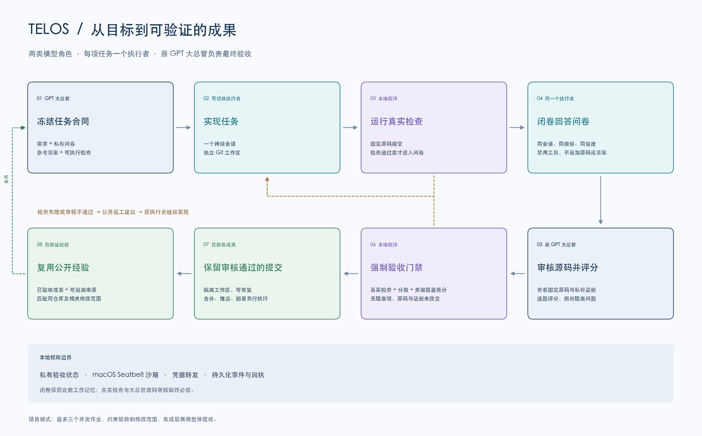
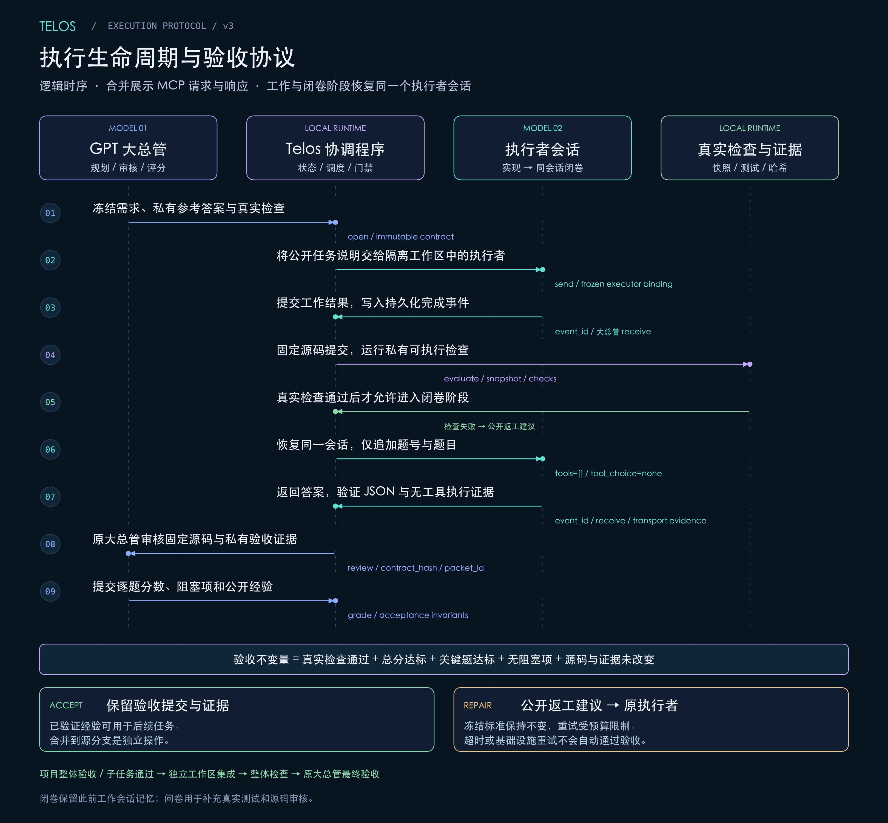

# Telos

**让编码目标变成可测试、可审核的成果。**

[English](README.md) · [快速开始](#快速开始) · [20 轮 RSI 结果](#20-轮-rsi-进化实验) · [架构说明](docs/architecture.md) · [配置指南](docs/configuration.md) · [MCP 工具](docs/tools.md)

[](https://github.com/pickupdwq/telos/actions/workflows/ci.yml)
[](LICENSE)


Telos 是运行在本机的 Codex MCP 桥接程序。原来的 GPT 旗舰对话担任**大总管**，负责理解需求、冻结验收标准、审核源码和最终评分；可切换的**执行者**负责实现功能，然后在同一个会话中闭卷回答问卷。

整个流程只有两类模型角色。每个任务只有一个执行者，审核与验收始终由原大总管负责。项目模式可以调度多个任务，每个任务有自己的执行者。

**20 轮 RSI 实验已完成：**接受 17 项改进，拒绝 2 项实验，最终任务对照结论为不确定。四进程并行使本地回归验证约快 **3.25 倍**；尚未证明百炼模型返回更快，也未证明同等质量下整个任务交付更快。[查看结果与边界 ↓](#20-轮-rsi-进化实验)

## 系统架构

[](docs/assets/architecture-zh.png)

从左向右阅读：原大总管通过 Telos 分派任务，执行者交回的完成事件和证据返回同一聊天。下半部分展示运行时约束与验收门禁。只有大总管和执行者是模型角色。

| 组成 | 核心职责 |
| --- | --- |
| 原大总管 + Skill | 理解需求，冻结范围与检查，审核证据并评分 |
| 本地 Telos 运行时 | 环境预检、调度、隔离、模型转发、用量与预算、持久回传和验收门禁 |
| 任务执行者 | 在指定边界内工作，再于同一会话中完成闭卷问答 |

[查看高清 PNG](docs/assets/architecture-zh.png) · [矢量 SVG](docs/assets/architecture-zh.svg) · [模块映射与协议详解](docs/architecture.md#中文说明)

## 功能

- **执行者可切换。** 默认使用 DeepSeek 官方 API，同时支持火山 Ark Coding Plan、OpenAI API 和本地端口。可保存多个本地入口，同一时间只启用一个，兼容 Responses 与 Chat Completions。
- **凭证据验收。** 在固定 Git 提交上运行预先冻结的真实检查，大总管再审核源码、给问卷评分。默认 90 分及格，还必须满足关键题最低分、所有检查通过、无阻塞问题。
- **同一执行者闭卷答题。** 保留原工作会话记忆，不提供新的源码、私有答案或检查结果。转发层禁用工具，并拒绝考试中的工具调用。
- **隔离工作。** 使用 Git worktree、macOS Seatbelt、私有验收目录和本地凭据转发，划分实现与评估的权限。
- **项目协作。** 大总管选择单任务、并行或分阶段执行；程序约束依赖关系和可修改路径。最多同时运行三个作业，集成后还需整体验收。
- **可恢复执行。** 持久化事件、回执、有限重试、暂停/恢复/取消，以及默认只预览的归档与清理。
- **预检与用量控制。** 调用模型前检查工作环境，工具默认返回精简摘要，完整证据可补查；工作与考试的请求数和 token 用量持久记录。配置预算后约束后续请求，缺失用量保持未知状态。见[预算语义](docs/configuration.md)。
- **经验复用。** 从已通过验收的工作中提炼公开修复经验，用于同仓库的后续任务；保留来源，可停用过时经验。这是检索式积累，不是训练模型权重。
- **独立版本对比。** 通过 `telos compare` 冻结两个运行时和固定任务，复用当前大总管的执行、考试、审查流程，对比任务结果、用量和耗时。实验状态单独保存，不自动替换正式版本。见[评测与对比指南](docs/comparison.md)。
- **系统走查。** 大总管冻结公开清单和执行边界，执行者只读检查源码，通过受限探针验证接口、页面交互与布局，提交报告、日志和截图。大总管审核覆盖与证据，已确认问题可转成修复任务。走查通过表示检查质量合格，不表示系统没有 Bug。见[走查指南](docs/audits.md)。

Telos 在隔离工作区中产出已验收的提交。合并、推送和部署是后续独立操作。

## 20 轮 RSI 进化实验

2026 年 10 月 20–21 日，Telos 围绕速度、质量和可靠复用完成了 20 个实验。原始大总管使用 `gpt-6-astra`、推理强度 `max`；执行者使用阿里云百炼的 `deepseek-v4.1-flash-1017`、推理强度 `max`。实验从 main 的 `5e6a917` 出发，在 `feature/rsi-20-rounds-20261020` 分支开展。

每轮按“提出假设并冻结检查 → 限定范围实现 → 验证 → 原大总管审阅 → 接受或拒绝”推进。后续轮次实际使用了先前通过的工具：第 4 轮的验证 CLI，经第 8 轮加入精确选择、第 15 轮加入可选并行，再用于后续实验。这是监督下的软件与工作流递归改进；实验期间安装中的监督控制器保持固定，没有训练模型权重。

**结果：17 项源码改进被接受，2 项实验被拒绝（第 10、16 轮），最终对照不确定（第 20 轮）。** 被拒代码已排除。最终集成项目在 `20c68f6` 通过验收，其运行时与第 20 轮测量候选 `281757c` 字节一致。返工、最终验证和报告编写不另算轮次。

### 具体提升了什么

- **可复用的验证工具。** 验证 CLI 可安全导入，记录精确测试 ID、结果、范围和耗时；支持按模块、类、方法选择测试，并可用 `--jobs 1..4` 启用独立进程并行，默认仍串行。
- **本地处理效率。** 反向扫描加快日志尾部定位，批量扫描加快 SSE 用量解析；经验检索只校验排名后实际需要的来源，项目经验提升只读取对应的规范记录。这些收益限于具体本地路径。
- **可靠性与可观测性。** 经验复用校验当前验收来源，并隔离损坏记录；观察面板可处理异常时间戳，不把未知时间冒充当前时间。状态和考试摘要补充证据，转发诊断区分确认未发送的请求与协议错误。新增请求/时间和补丁格式提示，但尚未证明能降低真实重试率。

### 本次优化细节

**经验检索与提升——第 1、14、17、19 轮。** [experience.py](runtime/experience.py) 的 `lookup` 从遍历候选时逐个验证来源，改为先筛选、排序，再校验实际需要的来源，找到足够有效结果就停止。120 条记录的三个场景中，来源校验从 **120 / 120 / 120 次降至 3 / 3 / 5 次**，选出的记录 ID 一致；只查看候选时不做来源校验。JSON 记录集合仍需 O(N) 读取，这减少的是来源验证工作，并未实现索引检索。

`load_record` 对单条不可读、JSON 损坏或字段类型异常的记录做隔离，让有效邻居继续参与检索，且不改写文件。`source_valid` 将经验绑定到当前验收提交、证据包和可信项目归属，防止陈旧或改标签记录被复用。`promote_project` 从扫描整个经验集合，改为重建当前已验收子任务的规范记录：**300 次无关读取降至 0，只读 2 个目标**；缺失记录可重建，用户禁用偏好保留。验证覆盖 39 个损坏隔离场景、22 个来源身份场景和 15 个提升场景；尚不能据此推断真实任务成功率，也不承诺跨所有子任务原子提升。

**日志尾部定位与观察面板——第 3、18 轮。** [activity.py](runtime/activity.py) 的 `Reader.seek_tail` 将 Python 逐字节反向循环改为至多 64 KiB 块内的 `bytes.count` 和有界 `rsplit`，保留字节游标语义，直接定位所需换行边界。在热缓存的 3.85 MB、末尾 200 行样本中，相反顺序的配对中位耗时从约 **89.86 ms 降至 2.22 ms，约快 40.55 倍**，54 项独立语义断言通过。这是游标定位收益，不是整段日志处理耗时。[watch.py](runtime/watch.py) 则为损坏、非有限及平台无法表示的时间戳提供稳定排序和 `[??:??:??]` 显示，避免崩溃或把未知时间当作当前时间；观察面板验证覆盖 41 个场景、145 项断言。第 16 轮尝试的独立超长行丢弃缺陷仍未解决。

**SSE 用量解析——第 12 轮。** [isolation.py](runtime/isolation.py) 的 `SSEUsageTracker.feed` 从逐字节追加改为批量扫描无换行区段，每块选择一次分隔符搜索策略，处理跨块 CR/LF，并保留事件字节上限和超长事件丢弃语义。初版曾让密集空行场景慢 4.2–4.5 倍，被审阅拒绝；接受的是修复了该退化的版本。等价性检查覆盖 **1,003 个场景、349,538 项断言**；两种执行顺序的合成基准中，大事件约快 **61 倍**、超长输入约快 **254–258 倍**、小输入约快 **3.31–3.32 倍**。这些计时不包含网络和模型执行。

**测试选择、报告与并行——第 4、8、15 轮。** [verify_all.py](runtime/verify_all.py) 改为仅经 `main` 执行，提供 `--list`、可重复的 `--module` 和精确 `--test` 选择，并记录逐测试 ID、结果与耗时。后续执行者可以运行适合本地环境的子集，大总管保留全量宿主验证。可选 `--jobs 2..4` 将模块分配至独立新进程，按稳定报告顺序合并结果；子进程失败、结果缺失或格式异常会报失败，不能以覆盖不完整的报告冒充通过。默认仍串行。最终同提交、527 个测试的对照见下表，这套 CLI 已被后续轮次实际复用。

**项目回传——第 2、7 轮。** [projects.py](runtime/projects.py) 与 [compact.py](runtime/compact.py) 在完整和精简项目状态中提供 `return_event.id`、`return_event.status`，恢复回传事件身份时不必再读取私有 courier 文件。通知逻辑只在健康、活跃、仅有 running 变化且无需大总管动作时，抑制新唤醒；已有未完成事件、回执/提醒、完成结果和错误状态继续保留。检查覆盖两种视图下的 20 组阶段/状态组合，以及 24 个抑制状态、27 个保留的可操作状态、6 个既有 courier 状态；未测得真实回调延迟收益。

**闭卷考试格式与证据——第 5、9 轮。** [closed_book.py](runtime/closed_book.py) 对已验证的百炼/模型绑定显式设置 `text.format.type=json_object`，格式重试时给出准确的答案结构与题目 ID。考试仍禁用工具，严格解析器继续拒绝错误或不完整答案。每次尝试的 `format_valid`、有界 `format_error` 和请求格式标记保留到 [compact.py](runtime/compact.py) 摘要中，不复制模型任意错误文本；已用 3 份真实开发试验的考试回执验证两条摘要路径。改进的是协议可观察性，真实考试重试次数减少尚未证实。

**收尾预算与编辑指导——第 6、11、13 轮。** [isolation.py](runtime/isolation.py) 在受支持的工作阶段 Responses 请求中，依据当前请求预留和考试预留，补充实时的准入剩余时间与后续工作请求余量提示。转发场景实测余量 **2 → 1 → 0**，仍保留 3 次工作请求和 2 次考试请求。只有 `closeout.begin` 拒绝准入时才明确提示“未向上游发送请求”；后续超时继续归类为协议/传输问题，5 个 loopback 场景验证了该边界。[executor.py](runtime/executor.py) 还在预检成功后的初始/续接实现提示中补充原始补丁语法和限定范围的备用编辑建议。这些提示不放宽预算或权限，也不构成新的硬重试上限；第 13 轮仍发生 5 次补丁格式拒绝，因此不声称编辑失败已减少。

### “更快”具体指什么

最终本地验证在同一台主机上，对比**同一已验收提交、同样 527 个测试**：

| 原生回归验证 | 默认串行 | 可选四进程并行 |
| --- | ---: | ---: |
| 执行并通过的测试 | 527 | 527 |
| 失败 / 错误 / 跳过 | 0 / 0 / 0 | 0 / 0 / 0 |
| 耗时 | 162.63 秒 | 50.04 秒 |
| 相对串行的速度 | 1 倍 | **3.25 倍** |

完整测试 ID、报告顺序和结果一致，原有 395 个原生测试全部保留；**21 个安装器测试**也全部通过。最终确认包含一组串行/并行配对，第 15 轮另有相反执行顺序的验证。这测量的是本地测试执行速度，不是百炼响应延迟，也不是整个任务交付速度。[复现命令 →](docs/testing.md#selection-and-parallel-verification)

第 20 轮另外完成 **16 次真实模型试验：4 个预先保留案例 × 2 次重复 × 2 个版本**，两侧使用匹配的模型配置和预算，并交替安排执行顺序：

| 真实任务指标 | 基线 | RSI 候选 | 实测变化 |
| --- | ---: | ---: | --- |
| 最终验收通过 | 8/8 | 8/8 | 最终通过数相同 |
| 首次提交即通过 | 7/8 | 6/8 | 少 1 次首次通过 |
| 执行者请求数，含考试与返工 | 85 | 73 | −14.12% |
| 执行者 token | 1,263,538 | 827,156 | −34.54% |
| 服务商请求累计耗时 | 1,272.794 秒 | 1,317.912 秒 | **+3.54%** |
| 任务总耗时，含大总管审阅与等待 | 1,763.288 秒 | 2,333.199 秒 | **+32.32%** |

**这组对照未证明模型返回更快、整体交付更快，或任务质量保持不变、普遍提高。** 服务商耗时是多个请求的累计值，不是单次请求首字延迟；最终通过数包含返工后的结果。token 节省集中于基线的一次审计：8 对任务中有 4 对候选使用更多 token，排除该次审计后，其余 7 对合计多用 62,251 token。

样本较小，人工审阅未盲，比较时禁用了经验复用，远端模型别名也没有不可变权重版本。补充诊断及其边界见[完整实验报告](docs/rsi-campaign-20261020.md)，没有据此事后修改冻结结果。

<details>
<summary>展开查看全部 20 轮</summary>

| 轮次 | 实验与结果 | 结论 |
| --- | --- | --- |
| 1 | 惰性校验经验来源，在保持检索结果一致的情况下减少来源验证。 | 接受 |
| 2 | 完整和精简项目状态暴露准确的回传事件 ID 与状态。 | 接受 |
| 3 | 有界反向日志定位；在实测 3.85 MB 样本中约快 40.55 倍。 | 接受 |
| 4 | 可安全导入的回归 CLI，记录精确测试 ID、结果、范围与耗时。 | 接受 |
| 5 | 百炼 JSON-object 考试格式与重试诊断；真实重试收益未证实。 | 接受 |
| 6 | 提供时间/请求余量提示，保留截止时间约束与考试预留。 | 接受 |
| 7 | 抑制仅显示 running 的新鲜唤醒，保留需处理事件与提醒。 | 接受 |
| 8 | 精确选择测试类/方法，默认全量覆盖保留。 | 接受 |
| 9 | 精简考试摘要保留安全的格式与解析元数据。 | 接受 |
| 10 | 请求耗时汇总在预算耗尽时仍未完整实现，代码排除。 | 拒绝 |
| 11 | 区分指定来源、确认未发送的准入关闭与协议错误。 | 接受 |
| 12 | 批量 SSE 用量扫描改善合成解析计时，保留流式处理边界。 | 接受 |
| 13 | 初始/续接任务增加补丁格式指导，真实格式错误仍有发生。 | 接受 |
| 14 | 检索和构造上下文时隔离不可读或损坏的经验记录。 | 接受 |
| 15 | 可选模块并行；本轮配对全量验证约快 3.30–3.33 倍。 | 接受 |
| 16 | 超长行跨 EOF 轮询丢弃状态修复未在预算内完成提交和考试；代码排除，原有限制保留。 | 拒绝 |
| 17 | 复用经验绑定当前已验收提交、证据与项目归属。 | 接受 |
| 18 | 观察面板时间戳显示与排序容错，未知值明确显示未知。 | 接受 |
| 19 | 规范记录提升：无关读取从 300 次降至 0，只读 2 个目标。 | 接受 |
| 20 | 最终匹配任务对照：未证明通用质量或整体速度提升。 | 不确定 |

</details>

整个实验批次，包括被拒工作、返工、考试、开发试验、协议探针和报告编写，共计 **945 次外部执行者请求、38,032,107 token**。该统计不含大总管用量，也不等同于货币费用。

[逐轮假设、结果与限制](docs/rsi-campaign-20261020.md) · [实验数据](docs/rsi-campaign-20261020.json) · [最终验收与验证摘要](docs/rsi-results-20261021.json)

逐轮报告冻结于最终交付检查之前，最终摘要补充记录其后完成的验收。这些数据属于指定提交的历史实测，不表示每次 README 更新都重新运行了版本对照。

## 环境要求与兼容性

| 组件 | 要求 |
| --- | --- |
| 操作系统 | 带 `/usr/bin/sandbox-exec` 的 macOS，或具备 Bubblewrap、Landlock、libseccomp 的 Linux；[Linux 条件与限制](docs/linux.md)。暂不支持 Windows |
| Python | 3.12+；运行时代码只依赖标准库 |
| Git | 已安装并配置；目标仓库至少有一个提交，工作区必须干净 |
| Codex CLI | **已验证基线为 0.163.0**；安装器允许更高版本，但升级后需重新验证 |
| Node.js / npm | 用于安装、运行专用 Codex CLI；CI 使用 Node.js 24 |
| 大总管 | 已登录 Codex，并使用允许列表中的 OpenAI GPT 旗舰模型 |
| 执行者 | 所选服务商的有效凭据/套餐，以及对应模型的使用权限 |

本地已在 Apple Silicon、macOS 27.0.1、Python 3.13、Codex CLI 0.163.0 上验证，不代表所有 Mac 或后续 CLI 版本均已实测。桌面端自动回传适配依赖内部 IPC 协议，推荐先使用下方专用 CLI 路径；升级后重新验证。

本分支新增独立 Linux 后端和 CI 验证。Linux 主机必须允许用户、挂载、PID 和网络命名空间；受限容器即使安装了依赖，也可能无法执行。安装器会真实探测，不会静默关闭隔离。云端工作坊是否提供原始 Codex 会话回传接口属于另一项条件，详见 [Linux 接入说明](docs/linux.md)。

## 快速开始

安装器会一起安装运行时和配套的**大总管 Skill**。全新安装仍拒绝覆盖已有文件；受管理的已有安装使用下方明确的 `--upgrade` 路径。仅克隆仓库不会升级正在使用的版本。

### 让 Codex 帮你安装

可以把下面这段话复制到另一个 Codex CLI 会话中。请附上仓库地址，方便 Codex 找到正确项目和安装说明：

> 请按照 https://github.com/pickupdwq/telos 的中文 README 安装 Telos 和用户全局 Skill。检查依赖，使用已验证的专用 Codex CLI 0.163.0，注册 MCP，并运行离线安装验证。已有安装先复用，除非我要求升级；保留现有配置和凭据。缺少的服务商 Key 由我在本地终端隐藏输入。完成后汇报验证结果，并提醒我在注册后重新打开 Codex。

- **同一台 Mac、同一份 Codex 配置下的另一个 CLI 会话**：复用已有安装即可。重新打开 Codex，用 `/mcp` 检查 Telos 是否加载。
- **另一台机器**：需要能够访问本仓库，并满足上面的 macOS/Linux、Python 3.12+ 和专用 CLI 要求。配置自己的模型凭据，并在该机器上运行安装验证。

安装器回归覆盖全新安装、受管理升级、配置保留、冲突检查和失败回滚。离线运行时检查使用本地模型替身；真实 API Key、其他 CLI 版本及真实桌面会话自动回传仍需单独验证。复现命令见[测试指南](docs/testing.md)。

### 1. 克隆仓库，安装专用 CLI

```sh
git clone https://github.com/pickupdwq/telos.git
cd telos
npm install --prefix "$HOME/.local/share/telos-cli" @openai/codex@0.163.0
```

该专用目录属于沙箱配置的一部分，不能仅用任意全局 `codex` 命令代替。

### 2. 安装运行时、Skill 并注册 MCP

```sh
python3 install.py --register
```

程序会复制运行时与[无密钥配置示例](config.example.json)，创建 `~/.local/bin/telos`，将 Skill 安装到 `~/.agents/skills/telos`，并向 Codex 注册 `telos` 服务。其他 MCP 与模型设置保留。Skill 对当前系统用户的各个项目可用，安装本身不会启动执行者。省略 `--register` 则只安装文件；加上 `--dry-run` 可检查计划而不写入。详见 [Skill 使用与安装](docs/skills.md)。

已有受管理安装，可在检出的新版源码中执行：

```sh
python3 install.py --upgrade --dry-run
python3 install.py --upgrade
```

升级保留现有配置、凭据、任务记录及启动入口，并保留运行时与 Skill 备份。检测到受管理文件被修改、Skill 冲突或任务正在运行时会拒绝升级。先暂停或完成活跃项目，等待作业及检查结束，升级后重新加载 MCP 客户端。自定义安装需沿用原来的 `--prefix`、`--bin-dir`，详见[升级说明](docs/skills.md#中文说明)。

首次启用 tmux 自动观察面板时，使用 `--upgrade --register`：安装器备份 Codex
配置，并为 Telos 补充动态 `TMUX`/`TMUX_PANE` 转发；之后在 tmux 中重启 Codex。
详见[观察面板说明](docs/watch.md)。

### 3. 配置执行者凭据

```sh
"$HOME/.local/bin/telos" auth deepseek
"$HOME/.local/bin/telos" doctor
```

在终端隐藏输入 Key；凭据写入仓库之外的本地文件，权限为 `0600`。也可使用已有且地址匹配的环境变量或 OpenCode 凭据。`doctor` 检查配置和凭据是否存在，不验证远端 Key 是否有效。

### 4. 验证安装

```sh
python3 "$HOME/.local/share/telos/verify.py" --report telos-verification.json
```

使用本地模型替身验证 MCP、原生回传和执行环境隔离，不调用付费模型，也不验证真实凭据。完整回归及可选的真实服务商验证见[测试指南](docs/testing.md)。

### 5. 在项目中启动大总管

```sh
# 当前 Codex 账号尚未登录时执行。
"$HOME/.local/share/telos/commands/codex" login
cd /你的/干净Git项目/绝对路径
"$HOME/.local/share/telos/commands/codex" --model gpt-6-astra \
  -c 'model_reasoning_effort="max"'
```

注册后重新打开已运行的 Codex 客户端，确认加载了 `telos_*` 工具。Telos 通过可信 MCP 元数据绑定原始 Codex 会话；没有这类元数据的通用 MCP 客户端不能直接替代大总管宿主。

### 6. 用自然语言发起任务

> $telos 实现这个功能：[需求]。沿用已配置的默认执行者。开始前冻结有针对性的真实检查和私有问卷，完成后由你检查源码与测试证据，在预算内返工直到验收通过。最后告诉我工作区位置和提交。

较大项目可以这样描述：

> 使用 Telos 完成[目标]。由你根据依赖判断单任务、并行或分阶段执行，为每项任务指定可修改路径，复用仓库中已验证的经验，集成后做整体验收。

可显式使用 `$telos`，也可用自然语言要求使用 Telos。Skill 指导大总管规划、划定边界和审核，MCP 执行流程并落实验收门禁；普通咨询不会启动执行者。执行者回复完成、收到回调都不等于验收通过，只有 `accepted=true` 才算通过。

系统走查可以这样发起：

> 使用 Telos 走查这个系统：[需求、仓库、测试环境和设计依据]。由你拆分任务，制定走查问卷和执行边界，检查代码、接口及关键页面交互与展示，审核实际证据，输出问题清单和未验证范围。本次仅走查。

页面走查需要指定本机已有的 Playwright 1.48+ 模块、Chromium 可执行文件、测试地址、允许动作和视口；Telos 不会自动安装依赖或使用个人浏览器资料。推荐独立 Chromium headless shell，配置与修复衔接见[走查指南](docs/audits.md)。

## 默认模型与推理强度

安装配置示例选择：

| 角色 / 配置名 | 渠道 | 模型 | 推理强度 |
| --- | --- | --- | --- |
| 大总管 | OpenAI / 原 Codex 对话 | `gpt-6-astra` | 上述启动命令设置为 `max` |
| 默认：`deepseek_official` | DeepSeek 官方 | `deepseek-flash` | `max` |
| 可选：`ark_coding_plan` | 火山 Ark Coding Plan | `glm-5.3-flash` | `max` |
| 可选：`openai_executor` | OpenAI API | `gpt-6.1-sol` | `xhigh`，示例中显式覆盖 |
| 可选：`bailian_deepseek` | 阿里云百炼，北京地域 | `deepseek-v4.1-flash-1017` | `max` |
| 可选：`local` | 当前选中的本地入口 | 本机配置的模型 ID | 默认 `none`，不向上游发送推理参数 |

云端执行者绑定未显式指定时默认 `max`；本地入口默认不发送推理参数，可以显式配置。大总管的推理强度继承原 Codex 对话，Telos 不会暗中修改。模型权限和可用强度以服务商支持为准，不兼容时明确失败，不静默降级。

截至 **2026-10-18**，DeepSeek 官方文档将 `deepseek-flash` 对应到 DeepSeek V4.1 Flash 1017。它是滚动别名，不是永远固定的日期快照，见[官方集成指南](https://api-docs.deepseek.com/quick_start/agent_integrations/)。

切换执行者时告诉大总管：

> 这个任务使用 Telos，执行者选 `executor_profile=ark_coding_plan`。

配置文件位于 `~/.local/share/telos/config.json`。任务创建时冻结服务商、模型和强度，修改默认配置只影响新任务。更换执行者需要新会话，或使用受约束的项目重新分配流程。详见[配置指南](docs/configuration.md)。

百炼使用独立的 `DASHSCOPE_API_KEY` 或 `telos auth bailian` 凭据，通过 Responses API 接入。任务选择 `executor_profile=bailian_deepseek`；已有安装升级会保留配置，需补加此可选配置项。详见[百炼配置与地域边界](docs/configuration.md#alibaba-cloud-bailian)。

本地入口通过 `telos local add` 保存、`telos local select` 切换，任务选择 `executor_profile=local`。火山与 DeepSeek 配置继续保留。已创建的本地任务绑定原地址和模型，切换后需选回原入口才能续跑。[本地执行者配置与示例](docs/local-executors.md)

大总管可以使用现有 Codex 登录；OpenAI **执行者**需要单独的 API 凭据，本发布版没有将执行者请求转接到 ChatGPT/Codex 套餐。Telos 本身免费开源，模型 API 与套餐按各服务商规则计费；作业数量上限不等于费用上限。

## 验收流程

[](docs/assets/lifecycle-zh.png)

[查看高清 PNG](docs/assets/lifecycle-zh.png) · [矢量 SVG](docs/assets/lifecycle-zh.svg)

1. 大总管冻结需求、私有参考答案、题目分值和可执行检查。
2. 所选执行者在独立 Git worktree 中实现任务。
3. Telos 固定提交并运行检查，失败时先返工，不进入问卷。
4. 检查通过后，恢复**同一个执行者会话**闭卷答题，禁止工具；此前工作记忆仍保留。
5. 原大总管查看固定源码和私有证据，逐题评分、指出阻塞项。
6. 程序强制检查及格线、关键题最低分、真实检查结果与证据一致性。不通过可在轮数预算内返工；已通过工作的经验才有资格被复用。

默认最多五轮评估，包含首次。基础设施失败另有有限重试策略。闭卷回答补充真实测试与源码审核，单靠问卷不能证明代码正确。

## 日常操作与数据

`telos watch` 提供执行者实时记录、任务切换和历史回看。在 Ghostty 或 iTerm2
中通过 tmux 启动 Codex CLI 后，多个执行者共用一个自动打开的右侧观察面板，
焦点留在主对话；关闭面板不停止任务。非 tmux 环境可手动查看。
首次启用需要配置 MCP 环境转发，详见[观察面板使用说明](docs/watch.md)。

```sh
"$HOME/.local/bin/telos" watch
"$HOME/.local/bin/telos" watch <session_id> --history --no-follow
"$HOME/.local/bin/telos" status <session_id>
"$HOME/.local/bin/telos" pause <session_id>
"$HOME/.local/bin/telos" resume <session_id>
"$HOME/.local/bin/telos" cancel <session_id>
"$HOME/.local/bin/telos" recover
"$HOME/.local/bin/telos" cache --action inventory
```

暂停/取消会阻止后续阶段，已经发出的模型调用可能完成；取消后不能恢复。也可直接向原大总管说“暂停/继续/取消这个 Telos 任务或项目”。

| 位置 | 内容 |
| --- | --- |
| `~/.local/share/telos/` | 程序与无密钥 `config.json` |
| `~/.local/share/telos-cli/` | 专用 Codex CLI 依赖 |
| `~/.agents/skills/telos/` | 当前用户跨项目可用的大总管 Skill |
| `~/.config/telos/credentials.json` | 本地模型凭据 |
| `~/.local/state/telos/` | 私有合同、证据、事件和经验 |
| `~/.cache/telos/` | 工作区及隔离执行者会话 |

`TELOS_STATE_DIR` / `TELOS_CACHE_DIR` 可覆盖数据路径；旧 `exam_loop` 路径和环境变量保留读取兼容。删除工作区前使用归档/清理工具，运行中不要删除任务数据。停用 MCP 可在同一 Codex 配置下执行 `codex mcp remove telos` 并重启客户端，不会删除任务数据。

## 已知边界

- macOS 保留 Seatbelt；Linux 使用独立的 Bubblewrap、Landlock 和 seccomp 后端。二者均不等于虚拟机，也不能防御已被控制的宿主机。
- 命令默认不能访问网络；`dependency_paths` 只授予指定依赖目录的读取权限，需要时显式开启命令/检查网络权限。
- 含 `.codex/config.toml`、符号链接等特殊快照条目或特殊依赖布局的仓库可能需要兼容处理，程序不会自动绕过检查。
- 任务上下文与源码会发送给选定的模型服务商。私有评估资料不提供给执行者，但大总管可以读取；本地证据和日志也可能包含敏感信息。
- 走查探针仅支持明确指定的本地、测试或预发布环境；页面驱动支持 Chromium，阻止重定向、WebSocket、Service Worker 和下载。依赖这些能力的流程须标为未验证。组合模型不保证必然优于单模型。
- 桌面自动回传、服务商接口兼容需要单独端到端验证，不能仅凭 socket 存在或 `doctor` 成功判断。

## 开发与贡献

```sh
python3 -m unittest discover -s tests -v
mkdir -p .artifacts
python3 runtime/verify_all.py .artifacts/regression.json

# 可选：最多四个模块进程，运行相同的全量运行时套件。
python3 runtime/verify_all.py .artifacts/regression-parallel.json --jobs 4
```

运行时验证在 macOS/Linux 上使用本地模型替身，不调用付费模型。用 `--list` 可只查看测试 ID 而不执行，`--module` 选择模块，`--test` 精确选择类/方法；聚焦运行只覆盖所选测试。参见[贡献指南](CONTRIBUTING.md)、[测试与选择示例](docs/testing.md)、[安全说明](SECURITY.md)和[更新记录](CHANGELOG.md)。架构图以 PNG/SVG 提供，由 [scripts/render_architecture.py](scripts/render_architecture.py) 生成。

## 开源许可

采用 [MIT License](LICENSE)，覆盖本仓库代码与文档。Codex、模型服务及其他外部依赖仍适用各自许可与服务条款。Telos 是独立项目，并非 OpenAI、DeepSeek 或火山引擎的官方产品。
