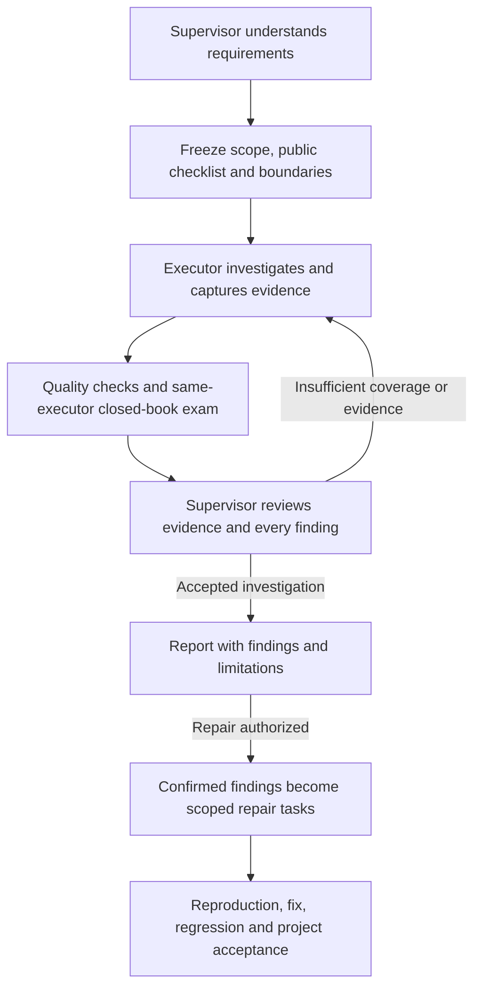

# System audits / 系统走查

An audit accepts an evidence-backed investigation of a frozen scope. It does **not** certify that a system has no bugs. The original GPT conversation remains the supervisor; each task has one executor and uses existing callbacks, same-thread closed-book exams, budgets and review gates.

走查验收针对**约定范围的检查质量和证据**。发现真实缺陷可以通过走查验收；缺少必要检查、伪造或缺失证据、没有大总管审核则不能通过。代码修复与系统走查使用不同任务类型。

## Natural-language entry / 自然语言入口

> 使用 Telos 走查这个系统：[仓库、测试环境、需求与设计依据]。由你理解需求，选择单任务或项目模式，拆分检查范围，制定公开走查清单、执行边界和私有验收标准。检查代码、接口、关键页面交互与展示，记录复现步骤和实际证据，由你审核。此次仅走查；输出已确认问题、疑似问题、建议和未验证范围。

如果用户同时授权修复，再在确认问题后增加修复任务。走查本身不授权修改业务源码、扩大网络访问、安装软件或操作生产数据。

## Workflow / 流程



1. Use `telos_open` with `task_type="audit"`, or audit children in `telos_project_open`. The supervisor chooses single/parallel/phased execution. Read-only auditors may inspect overlapping source paths; each has separate artifacts and an executor thread. Project concurrency remains at most three jobs.
2. Freeze public `audit` boundaries/checklist **separately** from private `questions` and `checks`. Unknown defects need no invented answer: private references describe investigation quality, evidence and reasoning. Private checks assess the investigation, not whether all target business behavior already passes.
3. `telos_send` starts work. The executor reads declared source paths, writes reports/evidence and uses the constrained probe service. It cannot modify source or make arbitrary direct network calls. Its prompt includes boundaries, source version and artifact location.
4. `telos_evaluate` pins source and artifact hashes, validates coverage/evidence, runs private quality checks, then resumes the same executor for its closed-book exam. The public checklist guides work with tools; the exam remains a separate assessment with tools disabled.
5. `telos_review` returns the pinned report, evidence directory, screenshots, private questions and answers. The supervisor reads evidence, views **all captured screenshots referenced in the review packet**, independently verifies key findings, and calls `telos_grade` with `audit_review`.
6. Grading generates `audit-report-<round>.md` in private task state; `telos_status` returns its path. Source/evidence tampering invalidates acceptance. Archival preserves reports, screenshots and provenance.

## Frozen boundaries / 冻结的执行边界

The `audit` object is required. See [the complete example](../examples/audit-contract.json) and [generated schemas](tools.schema.json).

| Field | Meaning / 要求 |
| --- | --- |
| `environment` | Named `local`, `test` or `staging` environment. Production probes are not supported. |
| `scope_paths` | Literal source files/directories relative to the pinned repository; `.` grants repository reads. Source writes are denied. |
| `requirements` | Requirements, interface/design specifications and agreed judgment criteria. / 正确性的依据。 |
| `out_of_scope` | Explicit exclusions, possibly empty. / 不检查的范围。 |
| `stop_conditions` | When affected work must stop and return to the supervisor. / 越界、权限不足等情况的处理规则。 |
| `mutation_policy` | Public statement of permitted test-data effects. Source remains read-only. / 测试数据操作边界。 |
| `checklist` | Unique `id`, `kind`, `prompt`, `expected`, optional `required` (default true). Kinds: `code`, `api`, `interaction`, `visual`. Page items may select declared `viewports`; default is all configured viewports. |
| `targets` | Canonical HTTP(S) `origin`, literal `path_prefix` and allowed `methods`. Empty for offline code audits. / 地址、路径与方法白名单。 |
| `limits` | `max_probes`: default 30, maximum 200. `probe_timeout_seconds`: default 60, maximum 300. `max_artifact_bytes`: default 30 MB, maximum 200 MB. Existing model turn/round/job limits also apply. |
| `browser` | Existing Playwright module, Chromium executable, named viewports and allowed actions. Required for page items. No dependencies are automatically installed. |

Boundaries are visible to the executor. Read-only source, read paths, HTTP/browser routing, actions, probe budgets and report limits have programmatic checks. Business requirements and semantic endpoint effects still require judgment: a GET endpoint can itself have side effects. Use isolated test data and the smallest useful URL/method scope.

范围外发现记录线索并回传，执行者继续不受阻的范围内工作。需要扩大权限、增加范围或修复代码时，由大总管依据已有授权建立新任务；执行者不能修改冻结合同。

## API and browser probes / 接口与页面检查

Executors receive `TELOS_AUDIT_URL`, an ephemeral `TELOS_AUDIT_TOKEN`, `TELOS_AUDIT_SOURCE` and `TELOS_AUDIT_ARTIFACTS`. `audit-probe-help.json` in their artifact directory documents requests. POST to the local service with `Authorization: Bearer <ephemeral token>`. This token is task-scoped, not a provider key. The supervisor may call `telos_audit_probe` before evaluation under the same boundaries.

```json
{
  "request_id": "save-mobile-1",
  "check_id": "save-form",
  "kind": "browser",
  "url": "http://127.0.0.1:8000/forms/new",
  "viewport": "mobile",
  "steps": [
    {"action": "fill", "selector": "#name", "value": "fixture"},
    {"action": "click", "selector": "#save"},
    {"action": "assert_text", "selector": "#result", "value": "Saved"}
  ]
}
```

- Supply an existing **Playwright 1.48+** module and Chromium executable. A dedicated Chromium headless shell is recommended and locally verified; desktop Chrome can fail under Seatbelt and is reported blocked instead of running unsandboxed.
- Actions: `click`, `fill`, `select`, `press`, `assert_text`, `assert_visible`, `assert_url`, `screenshot`. Only explicitly granted actions are accepted. Arbitrary executor JavaScript is not supported.
- Every probe creates a fresh context. Include login and the full operation sequence in one probe. Personal browser profiles/cookies are not reused.
- Captures initial/step screenshots, browser version, viewport, final URL, visible text, request statuses, console/page errors and horizontal-overflow geometry. Evidence supports supervisor review; it does not automatically prove visual correctness.
- HTTP/page redirects, WebSockets, service workers and downloads are blocked. Requests outside declared origin/path/method scopes are blocked and recorded. Flows requiring these capabilities must be reported blocked, not passed.
- A repeated `request_id` returns its recorded result without repeating the operation. Changed arguments and uncertain prior outcomes fail closed. Pause/cancel prevents new probes; an already-issued operation may complete.
- HTTP probes accept an allowed URL/method, optional headers and a bounded text body. Response evidence contains status and a bounded body. Failures can establish findings. Use scoped test accounts; reports may contain sensitive response or page data.

视觉检查有设计稿时按设计稿验收；没有设计稿时检查信息清晰、风格一致、遮挡溢出和基本可用性。审美建议与缺陷分开。大总管实际查看截图；执行者不支持图像理解时仍可负责操作与采证。当前提供 Chromium 桌面/手机视口检查，不声称覆盖真实移动设备、Safari、Firefox 或全部业务状态。

The driver follows Playwright's documented [context routing](https://playwright.dev/docs/api/class-browsercontext#browser-context-route), [WebSocket routing](https://playwright.dev/docs/api/class-browsercontext#browser-context-route-web-socket) and [bounded redirect handling](https://playwright.dev/docs/api/class-route#route-fetch).

## Evidence and acceptance / 证据与验收

The bridge creates a `report.json` template. The executor completes it in the artifact directory:

- `source_commit` and `environment` match the frozen task.
- `results` has exactly one entry per checklist ID: `status`, `actual`, `steps`, `evidence`, plus `reason` for `blocked`/`not_tested`.
- `passed` and `finding` need evidence files and reproduction steps. API/page results require matching bridge-captured evidence. Page results must cover their declared viewports with screenshots.
- `findings` contain unique IDs, checklist ID, `category` (`defect`, `suspected`, `suggestion`), severity, title, expected/actual behavior, steps, evidence and location.
- Required items must be investigated. Optional unverified items retain their reasons and require supervisor acknowledgement. Missing coverage never silently counts as passed.

Private quality checks read `TELOS_AUDIT_REPORT` and `TELOS_AUDIT_ARTIFACTS` in a verification snapshot. Evidence is copied to private storage and hashed before the exam. Artifact symlinks/hard links are rejected. The byte limit is validated at submission, not a filesystem quota.

`source_commit` pins the inspected repository; it does not prove a running service was deployed from that commit. If deployment identity matters, include a version endpoint or equivalent independent evidence in the checklist.

`audit_review` requires a decision and rationale for every finding (`confirmed`, `unconfirmed`, `dismissed`, `suggestion`), optional unverified checklist IDs in `limitations`, screenshot paths actually inspected in `visual_evidence_reviewed`, and a `coverage_rationale`. This records supervisor accountability; software cannot guarantee correct screenshot interpretation. Existing score/critical-question/check/blocker gates remain mandatory. Results explicitly report `system_health="not_asserted"`.

## Projects and repair / 项目与修复衔接

Audit children use `allowed_paths=[]`. Independent read-only auditors may overlap; implementation tasks retain existing write-scope/dependency rules. Final checks can read child report directories beneath `TELOS_AUDIT_REPORTS`; final review includes child evidence and supervisor decisions.

When repair is authorized, create an implementation task with `repair_of={"session_id":"accepted audit ID","finding_ids":["F1"]}` and explicit `allowed_paths`. Only supervisor-confirmed findings from an accepted audit of the same repository qualify. In projects, append repair tasks with dependencies on corresponding audits. Freeze reproductions and regressions before sending work. Keep private questions/checks out of executor messages.

合并、推送、部署仍是独立操作。报告注明实际检查的版本、环境和未验证范围；修复后按范围完成集成回归。
